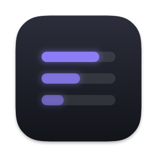
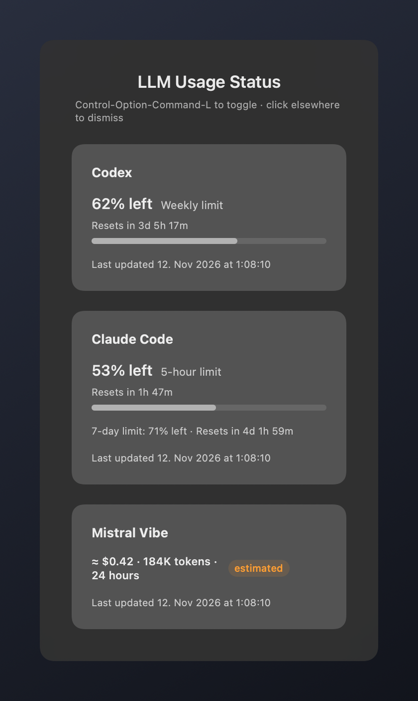
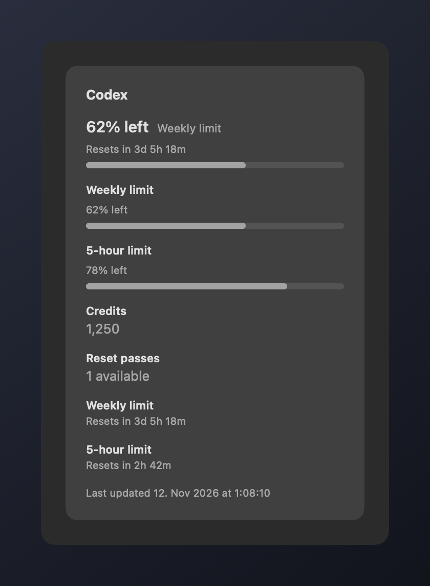
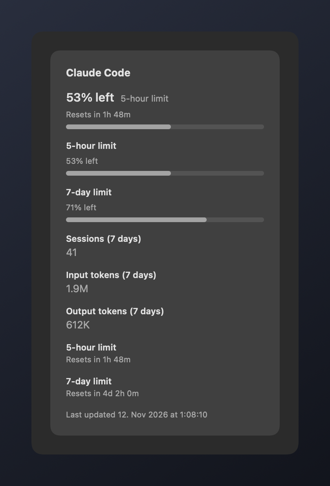

<div align="center">
  
  <h1>LLM Usage Status</h1>
  <p>A dockless macOS HUD that shows usage for multiple LLM command-line tools — Codex, Claude Code and Mistral Vibe — in one panel, on a hotkey.</p>

  
  
  
  
  [](https://github.com/Xpycode/LLM-UsageStatus/releases/latest)
  [](#install-with-homebrew)
  

  <br><br>
  
</div>

## What's New in Version 0.2.2

- **Providers in Settings** — turn Codex, Claude Code or Mistral Vibe on or off. A provider that is
  off is hidden from the panel and never read.
- **Correct Vibe numbers** — earlier versions counted cached and reasoning tokens twice, so token
  totals and the cost estimate were too high. Totals now match Vibe's own counters and survive
  log rotation; sub-agent sessions fold into the session that started them.
- **Shortcuts follow your keyboard layout** — refusals and Command-Comma work on QWERTZ and AZERTY,
  and the ISO key next to Left Shift can be part of the shortcut.

See the [CHANGELOG](CHANGELOG.md) for every release.

## Why This Tool Exists

Each LLM CLI reports its usage differently: some through undocumented
endpoints, some only through local logs, and one has no usage API at all.
Checking each one separately means digging through files or settings you
cannot reach. LLM Usage Status collects what is available and shows it in a
single panel summoned by a global keyboard shortcut, so current utilization,
allowances, and renewal times are one keystroke away.

## Features

- One panel, one section per provider — Codex, Claude Code, and Mistral Vibe.
  A CLI that is not installed shows "not detected"; one provider failing never
  breaks the other sections.
- Utilization meters and renewal countdowns per provider.
- Estimated values are always visibly labeled as estimates — the panel never
  presents a guess as an authoritative allowance.
- Per-provider preferences in a right-click menu, including the optional Codex
  five-hour limit line; settings persist across restarts and update the open
  panel immediately.
- Refresh on open; a failed refresh retains the last successful values with a
  visible stale-data message and the last update time.
- Hotkey fallback: when the shortcut cannot be registered, a warning menu-bar
  item appears and offers Show HUD, Retry Shortcut, Settings, Help, and Quit.
- Settings window: turn each provider on or off, launch at login, a
  rebindable show/hide shortcut, and the app's version.
- A provider that is turned off is hidden from the panel and never read — no
  file, Keychain or network access for it.
- Shortcut names follow your keyboard layout: on a German layout a chord
  recorded on the key labelled Z reads "Z", not the US "Y". Function, arrow,
  and other special keys keep their spelled-out names.
- Built-in Help window with searchable topics, plus Send Feedback… and Leave a
  Tip in the right-click menu.

## Screenshots

Rendered from the app with sample values.

<p align="center">
  
  
</p>

## Quick Start

Press **Control-Option-Command-L** anywhere to toggle the panel. Clicking
anywhere else dismisses it; drag the panel to move it. Opening the panel
refreshes usage. Right-click the panel for section preferences, Settings,
Help, Restart, Send Feedback…, Leave a Tip, and Quit.

### Settings

Open Settings from the panel's right-click menu, or press **Command-Comma**
while the panel is showing (the app does not take Command-Comma from other apps
while the panel is hidden). Command-Comma follows the keyboard layout: it is
Command plus whichever key types a comma, on AZERTY too. Changes apply
immediately; Escape or Command-W closes the window.

- **Providers** — one checkbox each for Codex, Claude Code, and Mistral Vibe,
  all on by default. A provider that is off has no panel section, no refresh,
  and no right-click items (Show 5-hour limit hides with Codex, Set Vibe
  Monthly Budget… with Vibe). With all three off the panel says so. Turning
  one on while the panel shows brings it back and refreshes it.

- **Launch at login** — shows the real state from macOS, including changes made
  in System Settings → General → Login Items. If macOS asks for approval, the
  window offers **Open Login Items…**. The option is available only when the app
  runs from an Applications folder; elsewhere (a build folder, Downloads, a disk
  image) it is disabled with the reason.
- **Shortcut** — click the field and press a new chord. It must include Command
  or Control; Command-Comma is reserved, and standard Command chords such as
  Command-C or Command-Space are refused. The check follows the keyboard
  layout: on German QWERTZ the key labelled Z is refused with Command and the
  key labelled Y is accepted. The ISO key next to Left Shift can be used. A
  chord another app already holds is refused and the previous shortcut keeps working. **Reset to Default** restores
  Control-Option-Command-L. The shortcut persists across restarts.
- **About** — name, version and build number.

Shortcut names (in the recorder, the panel footer, and the warning menu) use
the keycap letters of your current keyboard layout, and an open recorder
updates when you switch layouts. With a non-Latin input source such as Russian,
names come from your last Latin layout. Only the name changes — the shortcut
itself stays bound to the same physical key.

### Help, Feedback, and Tip

- **LLM Usage Status Help** — in the right-click menu (and in the warning
  menu-bar item). Opens a Help window with topics in a sidebar and search.
  Escape or Command-W closes it; Command-? reopens it while Help or Settings is
  in front.
- **Send Feedback…** — opens a short form. Your message (and the email address,
  only if you enter one) is sent to the developer's feedback server together
  with the app version and macOS version, only when you submit. No logs, usage
  data, or credentials are attached.
- **Leave a Tip** — opens the developer's tip page in your default browser.

### What each section shows

- **Codex** — weekly allowance and its renewal countdown, credits, available
  reset passes, and an optional five-hour limit line.
- **Claude Code** — subscription utilization (five-hour and seven-day windows)
  with renewal times when you are signed in; otherwise, labeled local estimates
  computed from your session logs.
- **Mistral Vibe** — pay-per-token usage with no usage API: sessions, token
  totals (input plus output; cached and reasoning tokens are inside those and
  not counted twice) and an estimated cost line only when model prices
  resolve. The all-time total comes from Vibe's own per-session counters, so
  it matches Vibe and survives log rotation; sub-agent sessions fold into the
  session that started them. The cost is an estimate, not a bill.

## Requirements

- macOS 15 or later
- At least one of: Codex, Claude Code, or Mistral Vibe (detected
  automatically; endpoint data additionally requires being signed in)
- [XcodeGen](https://github.com/yonaskolb/XcodeGen) and Xcode, only when
  building from source

## Installation

Updates are installed manually for now; built-in automatic updates are planned.

### Install with Homebrew

With [Homebrew](https://brew.sh/) installed, add the project's own tap and install:

```sh
brew tap xpycode/llm-usagestatus https://github.com/Xpycode/LLM-UsageStatus.git
brew install --cask xpycode/llm-usagestatus/llm-usagestatus
```

To upgrade later:

```sh
brew update
brew upgrade --cask xpycode/llm-usagestatus/llm-usagestatus
```

This is the project's own tap, not a listing in Homebrew's official catalogue. You can inspect the
[cask definition](Casks/llm-usagestatus.rb); maintenance notes are in [docs/homebrew.md](docs/homebrew.md).

### Download

Download the notarized disk image from
**[GitHub Releases](https://github.com/Xpycode/LLM-UsageStatus/releases/latest)** or the
[apps site](https://apps.lucesumbrarum.com/dl.php?app=llm-usagestatus)
(macOS 15 or newer, Apple silicon and Intel).

SHA-256 of `LLM-UsageStatus-0.2.2.dmg`:
`a4fbe57aa2fb864e9b6d7181073ce36800746fed5c5f91044957afa59d20136a`

1. Optionally check the download: `shasum -a 256 <file>` should print the value above.
2. Quit any older copy of LLM Usage Status normally.
3. Open the disk image and drag `LLM-UsageStatus.app` onto the Applications folder.
4. Launch it. No dock icon appears; the shortcut works immediately.

### Build from Source

```sh
git clone https://github.com/Xpycode/LLM-UsageStatus.git
cd LLM-UsageStatus/01_Project
xcodegen generate
xcodebuild -project LLM-UsageStatus.xcodeproj -scheme LLM-UsageStatus -configuration Release -destination 'platform=macOS' build
```

The unit-test target is app-hosted: running tests launches the application
briefly and registers its global hotkey. Building with the commands above only
compiles.

## Privacy and Data Sources

The app reads only local files owned by each CLI (`~/.codex/auth.json`,
`~/.claude/projects/**/*.jsonl`, the Vibe session store under
`~/.vibe/logs/session/unified/`) plus the Codex and Claude usage endpoints. Tokens are read in memory and sent
only as authentication headers to their own usage service. The only other
outgoing request is a feedback message you submit yourself through Send
Feedback…. No credentials or telemetry are logged, stored, or transmitted
elsewhere;
sandboxing is disabled so the app can read these user-owned files outside an
app container. A provider turned off in Settings is not read at all. Saved
locally: which providers are on, the per-provider display toggles, the Vibe
budget, the shortcut, window positions, and the last-seen usage values for
each provider (`~/Library/Application Support/LLM-UsageStatus/last-sections.json`,
so a relaunch can show them with their timestamps; no credentials).

## Caveats

- The usage endpoints used by Codex and Claude Code are undocumented and may
  change without notice; fields may become unavailable. The panel labels such
  windows as unavailable rather than guessing.
- This is a display-only utility: it never buys credits, redeems passes, or
  mutates any CLI's state.

## Architecture

```
LLM-UsageStatus/
├── 01_Project/          # XcodeGen project
│   ├── Sources/
│   │   ├── App/         # Entry point, hotkey, panel controller, composition
│   │   ├── Features/    # Usage status views and preferences
│   │   └── Shared/      # Provider protocol, models, per-provider services
│   ├── Resources/       # Asset catalogs, Help topics, third-party notices, entitlements
│   ├── HelpMenu/        # Vendored Help window package (MarkdownUI)
│   ├── Vendor/          # Vendored feedback and tip packages
│   └── Tests/           # Unit tests mirroring source modules
├── Casks/               # Homebrew cask (this repository is its own tap)
├── scripts/             # Release build and notarization scripts
└── .github/workflows/   # CI: build + test on push
```

Every provider implements the same `Provider` protocol; the HUD renders one
section per provider, so adding a provider is a contained change.

## Troubleshooting

### Problem: Nothing appears when pressing the shortcut
**Solution:** Another application may own the shortcut (Control-Option-Command-L
by default). A warning menu-bar item appears in that case; free the shortcut in
the other app and choose Retry Shortcut, or pick a different shortcut in
Settings. The item disappears once registration succeeds.

### Problem: A section shows "not detected"
**Solution:** The CLI is not installed, or its local data files are missing.
Install the CLI and use it once; the section populates on the next refresh.

### Problem: Values are stale or marked as estimates
**Solution:** Endpoint-backed data refreshes when the panel opens; if a refresh
fails, prior values are retained and marked stale. Claude and Mistral sections
label local estimates explicitly whenever endpoint data is unavailable — this
is expected behavior, not an error.

## Contributing

Bug reports and ideas are welcome — open an issue, or use Send Feedback… in the app.
Pull requests are welcome too; please run the tests before submitting.

## License

MIT. See [LICENSE](LICENSE). Third-party notices (MarkdownUI, NetworkImage,
cmark) ship in the app bundle as `ThirdPartyNotices.txt` and live in
`01_Project/Resources/Licenses/`.
